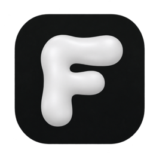
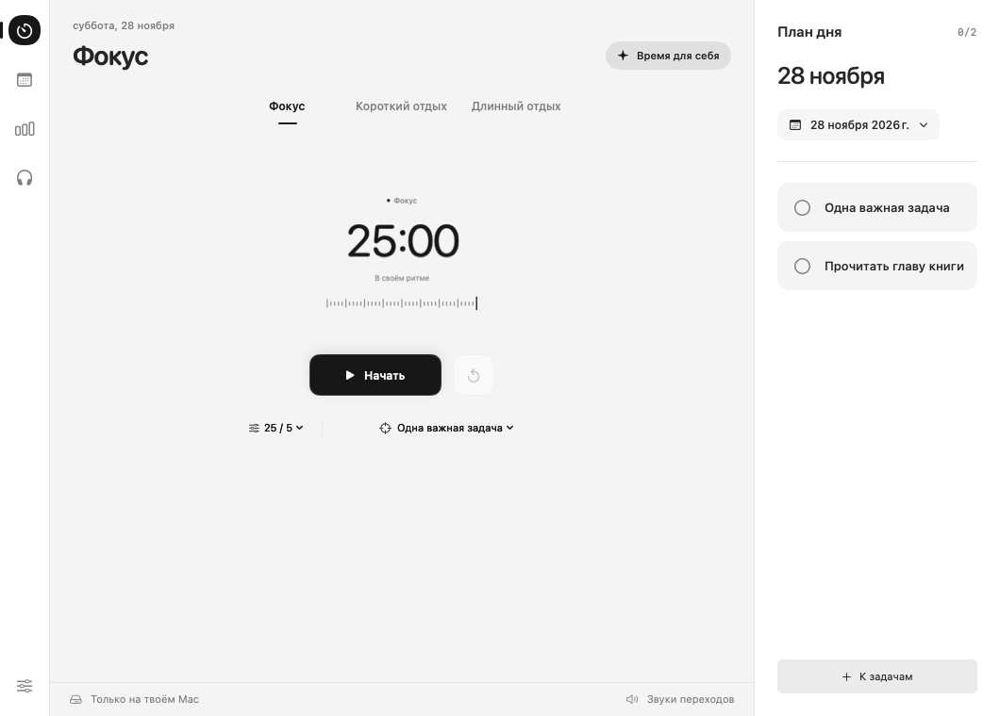
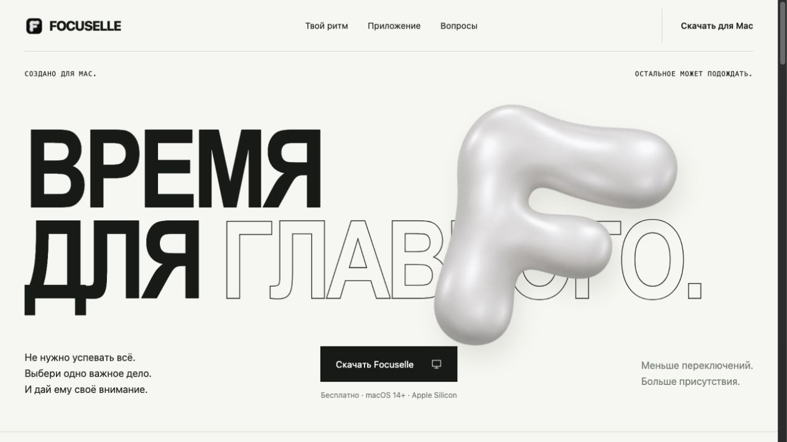

<p align="center">
  
</p>

<h1 align="center">Focuselle</h1>

<p align="center">Время для главного. Нативный Pomodoro для Mac.</p>

<p align="center">
  <a href="https://mrdisa.github.io/Focuselle/">Сайт</a> ·
  <a href="https://mrdisa.github.io/Focuselle/downloads/Focuselle-0.2.0-arm64.dmg">Скачать для Mac</a> ·
  <a href="#разработка">Собрать из исходников</a>
</p>

Focuselle помогает выбрать одну задачу, сосредоточиться на ней и вовремя отдохнуть. Таймер, план дня и статистика работают локально — без регистрации и подключения к серверу.

**v0.2.0 · Early access · macOS 14+ · Apple Silicon (M1 и новее)**

## Приложение

<p align="center">
  
</p>

Реальный скриншот приложения: сохранённая сессия восстановлена на паузе. При уменьшении окна остаются цель, круг таймера и управление сессией.

## Лендинг

[](https://mrdisa.github.io/Focuselle/)

[Открыть сайт](https://mrdisa.github.io/Focuselle/) · [Скачать .dmg](https://mrdisa.github.io/Focuselle/downloads/Focuselle-0.2.0-arm64.dmg)

## Возможности

- **Свой ритм.** Пресеты 25/5, 50/10, 90/10 и настраиваемая длительность работы и отдыха. Работа — 1–240 минут, короткий отдых — 1–120 минут.
- **Переходы без лишних действий.** Работа и короткий отдых чередуются автоматически; автопереходы отключаются в настройках. Длинный отдых выбирается вручную.
- **Звуки переходов.** Разные сигналы начала работы и отдыха, прослушивание в настройках и выключатель на главном экране.
- **План дня.** Календарь, добавление, редактирование, описание, завершение и удаление задач. Цель сессии выбирается прямо над таймером.
- **Понятная статистика.** Время фокуса, завершённые сессии, активные дни, график за 7/30 дней и распределение времени по задачам.
- **Компактный режим.** Минимальное окно 340×400 pt, плавающий мини-таймер и управление из строки меню. Закрытие основного окна не останавливает приложение.
- **Нативный интерфейс.** Светлая, тёмная и системная темы; русский и английский языки. Иконка Dock во время работы следует системной теме macOS.
- **Сохранение прогресса.** После перезапуска интервал восстанавливается на паузе. При уходе Mac в сон таймер тоже ставится на паузу.

Это ранняя версия. Фоновые звуки, уведомления, блокировка отвлекающих приложений, интерфейс подзадач и временных блоков пока не реализованы.

## Установка

1. Скачай [Focuselle-0.2.0-arm64.dmg](https://mrdisa.github.io/Focuselle/downloads/Focuselle-0.2.0-arm64.dmg).
2. Открой образ и перенеси **Focuselle.app** в **Applications**.
3. Запусти приложение из папки Applications.

Сборка предназначена для **Apple Silicon**. Версии для Intel пока нет. У приложения локальная ad hoc подпись, без Developer ID и нотариального заверения Apple: macOS может заблокировать загруженную копию. Минимальная версия macOS задана как 14.0; работа на самой macOS 14 отдельно не проверялась.

## Горячие клавиши

Удерживай **⌘**, чтобы увидеть подсказки рядом с иконками сайдбара.

| Действие | Сочетание |
| --- | --- |
| Фокус / План / Статистика / Звуки / Настройки | ⌘1 / ⌘2 / ⌘3 / ⌘4 / ⌘5 |
| Начать, поставить на паузу или продолжить | ⇧⌘S |
| Мини-таймер | ⇧⌘M |
| Показать или скрыть план дня | ⇧⌘P |
| Настройки | ⌘, |
| Завершить приложение | ⌘Q |

Смена ритма, фазы и цели доступна после сброса текущего интервала. Сброс сохраняет фактически отработанный фокус как прерванную сессию; отдых в историю фокуса не попадает.

## Разработка

**SwiftUI · AppKit · SQLite · без внешних зависимостей**

Для локальной сборки нужны macOS, Apple Command Line Tools и Python 3. Из корня репозитория:

```sh
./scripts/build.sh --run
```

Готовое приложение появится в `.build/Focuselle.app`. Также можно открыть `Focuselle.xcodeproj` в полном Xcode и выбрать **Focuselle → My Mac → Run**. Сборка через Xcode отдельно не проверялась.

Проверить таймер, хранение данных, миграции и расчёты статистики:

```sh
./scripts/test.sh
```

Собрать .dmg для архитектуры Apple Silicon:

```sh
./scripts/package-dmg.sh
```

Образ и файл SHA-256 сохраняются в `landing/dist/downloads/`. Для упаковки иконок используется `scripts/make-icon.py`, исходные варианты находятся в `branding/`.

## Лендинг и публикация

Статический сайт находится в `landing/dist/`. Запустить локально:

```sh
python3 -m http.server 4173 --bind 127.0.0.1 --directory landing/dist
```

Открой http://127.0.0.1:4173/. Публикация на **GitHub Pages** настроена в [deploy-pages.yml](.github/workflows/deploy-pages.yml): изменения `landing/dist/` в `main` запускают проверку контрольной суммы установщика и деплой сайта.

<details>
<summary>Локальные данные и восстановление</summary>

База SQLite: `~/Library/Application Support/Focuselle/focuselle.sqlite`. Настройки интерфейса сохраняются в UserDefaults.

- Схема версионируется через `PRAGMA user_version`; миграции транзакционные. Более новая неизвестная схема вызывает ошибку, а не сброс данных.
- Таймер сохраняется при основных действиях и каждые пять секунд работы. После аварийного завершения можно потерять до пяти секунд прогресса. Сон и время без приложения не засчитываются.
- Запись сессии и текущего состояния выполняется одной транзакцией. UUID предотвращает повторную запись завершения.
- Удаление задачи сохраняет историю фокуса и снимок её названия. Дата сессии привязана к локальному дню начала с сохранённым часовым поясом.
- Ошибка записи останавливает таймер и предлагает повтор сохранения. Недоступная база не подменяется пустой.

Тесты используют временные базы и не затрагивают пользовательские данные. Покрыты пауза и продолжение, автопереходы, восстановление, миграции, сохранение описаний задач, границы календаря и статистики, откат и повтор после ошибки записи.

</details>

### Встроенные обновления

Начиная с 0.3.0, Focuselle использует Sparkle 2.9.1. Приложение проверяет `https://mrdisa.github.io/Focuselle/appcast.xml` каждые 6 часов. Найденное обновление отмечается плашкой над настройками; нажатие открывает встроенную установку и перезапуск. Проверить обновления вручную можно в меню приложения и настройках. Сессия сохраняется на паузе при завершении приложения. Автоматическая установка без нажатия пользователя выключена.

Версии до внедрения Sparkle потребуется один раз обновить вручную. Далее приложение заменяет себя, сохраняя базу и настройки.

При первой сборке `scripts/prepare-sparkle.sh` скачивает SDK из официального релиза и проверяет закреплённый SHA-256. Xcode также запускает этот скрипт, связывает и встраивает framework. Если локально использовался SDK для проверки интеграции, загрузи официальный перед упаковкой релиза:

```sh
./scripts/prepare-sparkle.sh --refresh
```

Архивы обновлений подписываются Ed25519. Приватный ключ никогда не попадает в приложение, сайт или Git. По умолчанию инструмент `scripts/update-signing.sh` работает с Keychain. В текущем ограниченном окружении Keychain недоступен: ключ создан в игнорируемом файле `.secrets/focuselle-ed25519.key` с правами 0600; скрипт автоматически использует его, если файл существует. Сохрани резервную копию этого ключа в защищённом месте: он нужен для подписания последующих обновлений. Публичный ключ уже записан в `Focuselle/Info.plist`.

Для переноса подписи на другой компьютер можно указать путь к существующему 32-байтовому seed через `FOCUS_SIGNING_KEY_FILE`. Не создавай новый ключ для существующего канала обновлений без процедуры ротации.

Подготовить релиз:

1. Увеличь `CFBundleShortVersionString` и `CFBundleVersion` в `Focuselle/Info.plist`.
2. Выполни `./scripts/package-update.sh`. Скрипт соберёт приложение, сохранит ZIP с символьными ссылками, проверит подпись и добавит новую запись в `landing/dist/appcast.xml`.
3. Опубликуй ZIP, его SHA-256 и `appcast.xml` вместе через существующий деплой GitHub Pages. Не перезаписывай архивы уже выпущенных версий. Обновление `.dmg` и ссылки на лендинге для новых установок выполняется отдельно.

Для предварительной упаковки без изменения сайта: `./scripts/package-update.sh "$PWD/.build/staged-release"`. Упаковщик релизов требует официальный проверенный SDK. `FOCUS_ALLOW_LOCAL_SDK=1` предназначен только для локальной проверки.

Текущая сборка подписывается ad hoc. Для публичного выпуска без предупреждений Gatekeeper нужны Developer ID и notarization. Скрипт сборки поддерживает `FOCUS_CODE_SIGN_IDENTITY` для Developer ID; notarization выполняется отдельно. Проверки Ed25519 архивов обновлений включены независимо от Apple Developer ID.

`./scripts/test.sh` проверяет таймер и хранилище, подписи (включая отказ после изменения архива), метаданные ленты и запрет повторных номеров сборок. Перед публичным релизом нужен полный прогон обновления на Mac: старая сборка → обнаружение новой → установка → перезапуск → сохранённые задачи и сессии. В ограниченном окружении запрещены исходящие загрузки SDK и запуск локального HTTP-сервера, поэтому полный сетевой прогон здесь недоступен.
